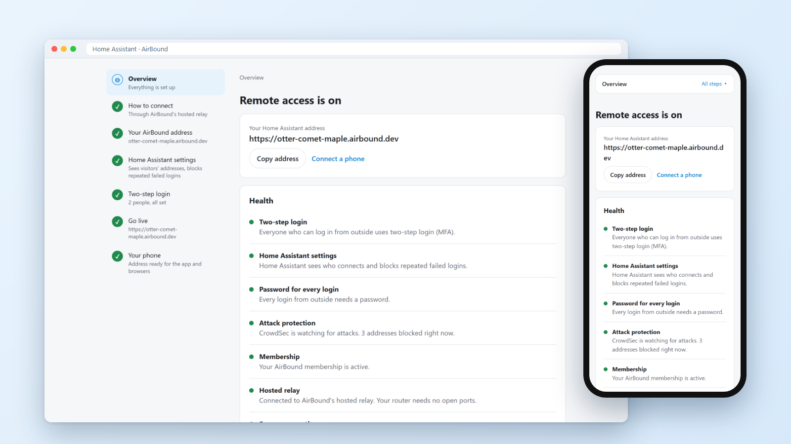
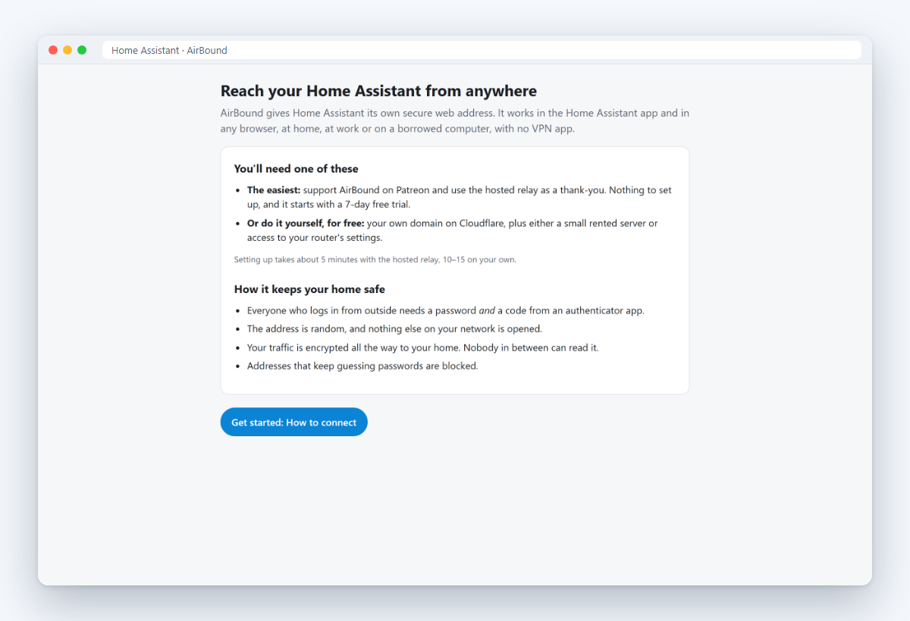
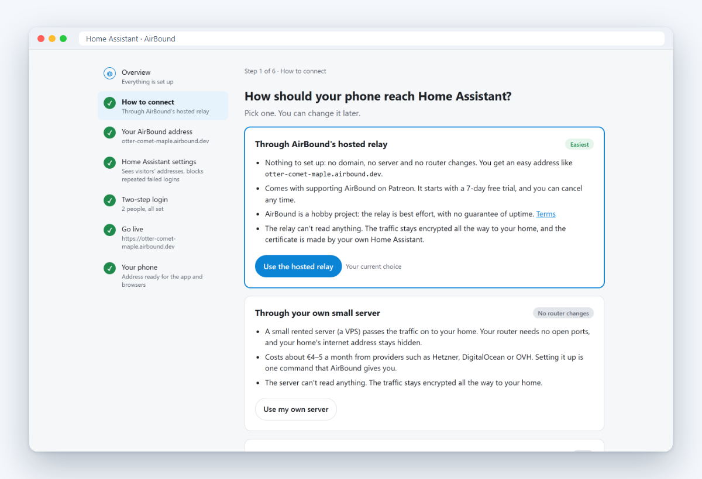
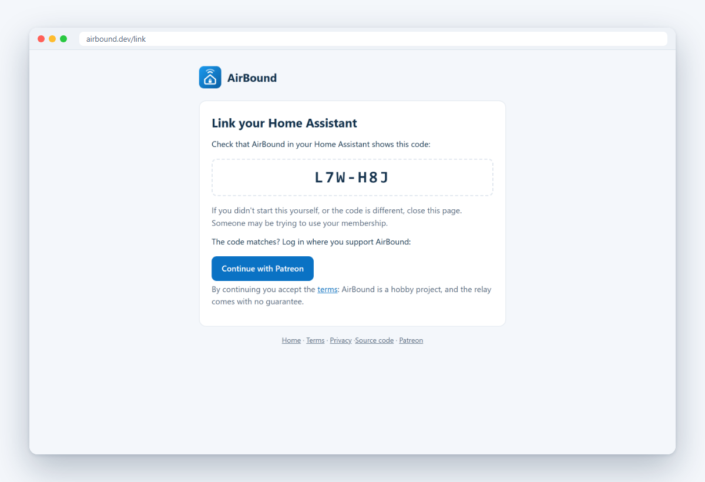
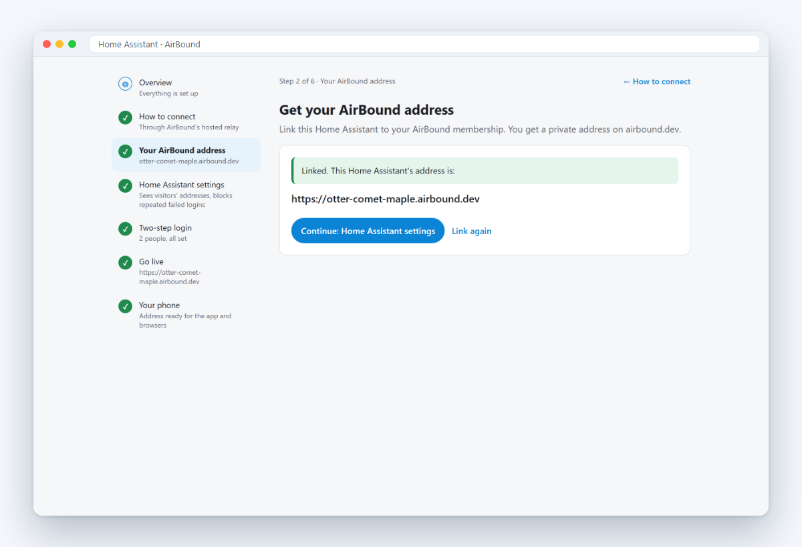

<p align="center"></p>

<h1 align="center">AirBound for Home Assistant</h1>

<p align="center">
  <a href="https://my.home-assistant.io/redirect/supervisor_add_addon_repository/?repository_url=https%3A%2F%2Fgithub.com%2Foleost%2FAirBound"></a>
</p>

<p align="center">
  
  
  
  <a href="LICENSE"></a>
</p>

> [!NOTE]
> **Early release.** AirBound works and is tested automatically before every release, but it is young and has few users so far. Expect rough edges, and changes to the setup wizard between versions. It is a hobby project with no warranty; keep another way to reach your home if you depend on remote access.

**AirBound gives your Home Assistant its own secure web address.** It works in the Companion app on iPhone and Android and in any browser, at home, at work or on a borrowed computer, with nothing extra to install and no VPN. A step-by-step wizard in the Home Assistant sidebar does the whole setup, so you never need to read documentation.

<p align="center"></p>

## Contents

- [Install](#install)
- [Three ways to connect](#three-ways-to-connect)
- [How it keeps your home safe](#how-it-keeps-your-home-safe)
- [The hosted relay](#the-hosted-relay)
- [Requirements](#requirements)
- [Development](#development)
- [Status](#status)

## Install

1. **Add the repository.** Select the button below. It opens your Home Assistant and asks to add the AirBound add-on repository.

   <a href="https://my.home-assistant.io/redirect/supervisor_add_addon_repository/?repository_url=https%3A%2F%2Fgithub.com%2Foleost%2FAirBound"></a>

   <details>
   <summary>Or add it by hand</summary>

   In Home Assistant, go to **Settings → Apps → Install app**, open the **⋮** menu at the top right, choose **Repositories**, and add:

   ```text
   https://github.com/oleost/AirBound
   ```

   </details>

2. **Install AirBound.** Find **AirBound** in the add-on store (reload the page if it isn't there yet), select it and choose **Install**.
3. **Start it** and turn on **Show in sidebar**.
4. **Open AirBound in the sidebar.** The wizard takes it from there: it explains every step, checks it for you, and only moves on when each part works.

<table>
  <tr>
    <td width="50%"></td>
    <td width="50%"></td>
  </tr>
  <tr>
    <td align="center"><b>1.</b> The wizard explains what you need</td>
    <td align="center"><b>2.</b> Pick how your phone reaches home</td>
  </tr>
</table>

## Three ways to connect

The first step asks how your phone should reach Home Assistant. You can change it later.

| | **Hosted relay** | **Your own server** | **Your router** |
| --- | --- | --- | --- |
| Setup | Log in with Patreon, about 5 minutes | One command on a small VPS | Forward one port |
| Router changes | None | None | One port forward (or automatic, with UPnP/NAT-PMP) |
| Your own domain | Not needed: you get `something.airbound.dev` | A domain on Cloudflare (free account) | A domain on Cloudflare (free account) |
| Cost | Support on Patreon, 7-day free trial | A VPS, about €4–5 a month | Free |
| Home address hidden | Yes | Yes | No |

**Linking to the hosted relay** works like signing in on a TV. AirBound shows a code, you open the link page, check that the code is the same, and log in with Patreon. AirBound picks up its address by itself.

<table>
  <tr>
    <td width="50%"></td>
    <td width="50%"></td>
  </tr>
  <tr>
    <td align="center">Check the code and log in with Patreon</td>
    <td align="center">AirBound gets its address, like <code>otter-comet-maple.airbound.dev</code></td>
  </tr>
</table>

## How it keeps your home safe

- **Two-step login is enforced.** Every login from outside needs a password *and* a code from an authenticator app. Logins without it are refused at the door, even though Home Assistant itself has no setting to require it. Logins at home are unaffected.
- **Encrypted all the way home.** The certificate is made and kept by your own Home Assistant (Let's Encrypt). Relays and DNS providers only move encrypted traffic and can't read it.
- **A hidden address.** A random name nobody can guess. On your own domain it's covered by a wildcard certificate, so the name never shows up in public certificate logs, and requests for any other name are dropped.
- **Certificate watch.** AirBound searches the public Certificate Transparency logs and warns you if anyone else gets a certificate for your address. On your own domain a CAA record also forbids it outright.
- **Attack protection.** CrowdSec watches the logs, blocks addresses that probe or guess passwords, and uses the community blocklist. Home Assistant's own login ban is turned on too. CrowdSec's blocks can be lifted from the panel; Home Assistant's permanent ones are listed there with how to remove them.
- **A backup can't go live by itself.** After a restore, on the same machine or a new one, AirBound keeps remote access off until you confirm in the panel. The hosted relay only accepts the machine that first used a key, so moving an airbound.dev address to a restored backup also needs your Patreon login, and AirBound warns you if a copy of the key is used anywhere else.
- **A locked-down relay server.** The one command that sets up your own server also turns on a firewall (only SSH and the relay's ports get in), SSH logins with keys only, and automatic security updates. The hosted relay runs the same setup.
- **Status in Home Assistant.** Health checks in the panel, plus sensors, events and notifications, for example when someone logs in from a new address.

## The hosted relay

The hosted relay is for people who don't want to deal with domains or servers. It runs on a server in Germany, at [airbound.dev](https://airbound.dev).

> [!NOTE]
> **AirBound is a hobby project, made by one person in their spare time.** Support on [Patreon](https://www.patreon.com/c/airbound) pays for its development, and access to the hosted relay comes with it as a thank-you. You're supporting a project, not buying a service: the relay is run on a best-effort basis, with no guarantee of uptime, no support agreement and no liability if it's down. Don't rely on it for alarms or anything safety-related, and keep in mind that you can switch to your own server or router at any time. See the [terms](https://airbound.dev/terms).

New supporters get a 7-day free trial, and Patreon shows the price in your own currency.

**What the relay can and can't see**

- It routes each connection by the address name and passes it on **without decrypting it**. It never sees passwords, pages or camera images.
- It sees which addresses connect, when, and how much data passes. How long it keeps what is on the [privacy page](https://airbound.dev/privacy), and the fair-use limits are in the [terms](https://airbound.dev/terms).
- It stores your Patreon member id and whether your membership includes the relay, not your name, email address or card. See the [privacy page](https://airbound.dev/privacy).

**Being honest about trust.** Whoever runs a domain can, in principle, get a certificate for any name under it. That includes the operator of airbound.dev. It can't be done quietly, though: every certificate is public, and AirBound warns you if one appears for your address that your Home Assistant didn't make. If you'd rather not depend on that, use your own domain with your own server or your router. The add-on works the same way.

**Run your own.** The relay is open source too. [`relay-server/`](relay-server) has the controller and an installer for Debian or Ubuntu, for anyone who wants to run a relay for family and friends.

## Requirements

- **Home Assistant OS**, 2026.8 or later (AirBound uses the HTTP settings API added then)
- **Hosted relay:** the Relay tier on Patreon (7-day free trial; best effort, see the [terms](https://airbound.dev/terms))
- **Your own server or router:** a domain managed by Cloudflare (a free account is enough), plus a small Linux VPS (Debian or Ubuntu) or access to your router's settings

## Development

The add-on lives in [`airbound/`](airbound), the hosted relay in [`relay-server/`](relay-server). Work happens on the `next` branch; `main` holds the released versions that Home Assistant installs. Unit tests run anywhere:

```sh
python -m venv .venv
.venv/bin/pip install -r requirements-dev.txt
.venv/bin/python -m pytest tests/unit tests/relay_server tests/ui
git config core.hooksPath .githooks   # the same tests before every push
```

The test environment, the test round, releases, and how every part is kept up to date are in [MAINTENANCE.md](MAINTENANCE.md). `python scripts/readme_screenshots.py` retakes the screenshots above, with real addresses and names replaced by examples.

## Status

| Part | State |
| --- | --- |
| Setup wizard, MFA enforcement, CrowdSec, sensors and notifications | Working on the test system, confirmed with the Companion app |
| Hosted relay (airbound.dev, Patreon login, shared SNI routing) | Working end to end on the test system; waiting for the first outside members |
| Your own server (relay mode) | Working end to end with a real VPS (Hetzner, Debian 13) |
| Direct through the router | Working; automatic port opening (UPnP/NAT-PMP) is unit-tested only |
| Restoring a backup, on the same or another machine | Tested on Home Assistant OS VMs, including a copied backup refused by the hosted relay; direct mode with a real router after a restore is untested |

AirBound was built with the help of AI (Claude Opus 5.5). Every release goes through a full test round on a Home Assistant OS VM, each Home Assistant beta is checked on a second VM before it is released, the relay server is tested on a private VM before it is deployed, and the whole chain has been confirmed on a real VPS at Hetzner.

AirBound is not affiliated with Home Assistant or Nabu Casa. If you can, consider supporting Home Assistant's development through [Home Assistant Link](https://www.nabucasa.com/), Nabu Casa's own remote access service, which funds the project.

## License

[MIT](LICENSE). AirBound is provided as is, without warranty of any kind; see the license for the full text.
